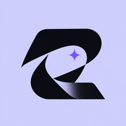
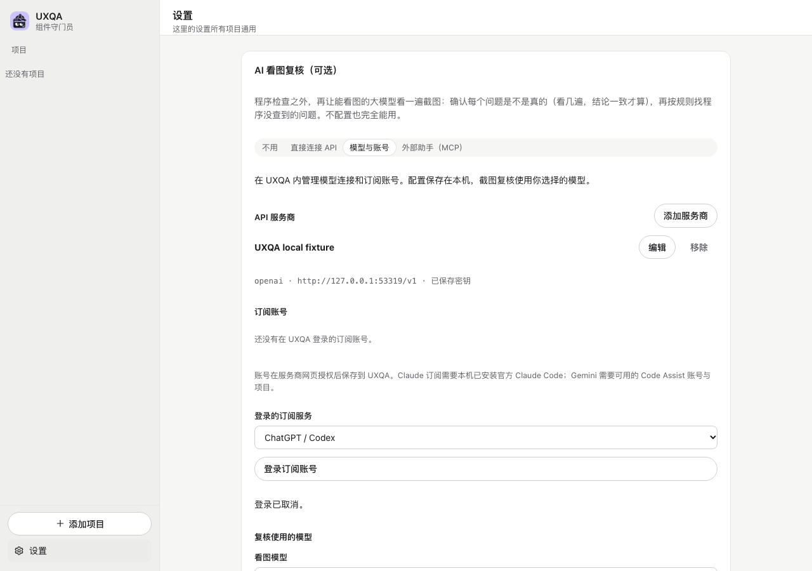

<p align="center"></p>

# UXQA

**Check the UI your AI built. Keep the evidence on your computer.**

[Download / 下载](https://github.com/kaxi9527/uxqa/releases/latest) · [安装与使用](docs/install-and-use.md) · [数据与权限说明](docs/local-data-and-permissions.md) · [Contribute](CONTRIBUTING.md) · [Report an issue](https://github.com/kaxi9527/uxqa/issues)

UXQA 是一个本地运行的界面检查工具：检查组件复用、页面溢出与可访问性，保存截图和复现证据，并可选择连接模型做看图复核。模型接入中心把协议配置、订阅登录和账号管理放在同一个产品里。

If UXQA helps you ship a better interface, a ⭐ helps others find it. Bug reports,
docs and small, well-tested PRs are equally welcome.



*模型接入中心预览，使用合成测试数据。 / Model access center with synthetic fixture data.*

A component gatekeeper for AI-written web frontends. It checks whether the AI used your own component library or rebuilt something the library already has, points to the file and line, and marks it on a screenshot. It also flags visual breakage such as overflowing or clipped text, overlapping elements and button labels that break as the page narrows. Results come from fixed rules, not a model, so any coding agent can run it and get the same answer. Product scope and limits live in [the product guide](docs/product-guide.md).

Standalone UX and frontend QA for arbitrary web products. Point it at a URL, optionally provide a JSON scenario, and get reproducible browser evidence without changing the product under test.

It runs Chromium through Playwright, checks page health and failed requests, evaluates accessibility with axe-core, exercises configured user flows, and captures screenshots plus Playwright traces. Product-specific behavior stays in the scenario file.

## 下载安装 / Downloads

**首次使用请看 [安装与使用说明](docs/install-and-use.md)**：选哪个包、Mac / Windows / Linux 解压启动、首次打开提示、第一次检测、更新卸载和常见故障。直接通过 GitHub 下载即可，无需应用商店。

Download a versioned archive from [Releases](https://github.com/kaxi9527/uxqa/releases).
Node and the UXQA model module are included. You do not need Magpie or a separate
Node installation. The interface is currently Chinese; this README includes English
developer instructions.

| Computer | v0.4.0 download | Start |
| --- | --- | --- |
| macOS 14+, Apple Silicon | [macOS arm64](https://github.com/kaxi9527/uxqa/releases/download/v0.4.0/UXQA-0.4.0-macOS-arm64.zip) | Open `UXQA.app` |
| macOS 14+, Intel | [macOS x64](https://github.com/kaxi9527/uxqa/releases/download/v0.4.0/UXQA-0.4.0-macOS-x64.zip) | Open `UXQA.app` |
| Windows 11+, x64 | [Windows x64](https://github.com/kaxi9527/uxqa/releases/download/v0.4.0/uxqa-0.4.0-win-x64.zip) | `Open uxqa console.cmd` |
| Linux x64, glibc (Ubuntu 22.04/24.04 recommended) | [Linux x64](https://github.com/kaxi9527/uxqa/releases/download/v0.4.0/uxqa-0.4.0-linux-x64.tar.gz) | `./open-uxqa-console.sh` |
| Linux ARM64, glibc | [Linux arm64](https://github.com/kaxi9527/uxqa/releases/download/v0.4.0/uxqa-0.4.0-linux-arm64.tar.gz) | `./open-uxqa-console.sh` |

macOS opens a native window. Windows/Linux open the same local UXQA console in your
browser; keep the launcher terminal open and press Ctrl+C to quit. Windows ARM64
has no native package in this release. Linux musl/Alpine is not a supported binary target.
Screenshot capture follows [Playwright's supported operating systems](https://playwright.dev/docs/intro#system-requirements);
Windows 10 is not an officially supported screenshot target.
See release notes for actual CI and manual validation; a build is not proof of every
OS version or subscription login working.

1. Download, verify `SHA256SUMS.txt` from the same Release and extract the whole folder.
2. Open the app/launcher. Packages are not notarized or signed with a trusted publisher
   certificate; follow the [trust and permissions guide](docs/local-data-and-permissions.md).
3. Choose a project. Screenshot capture offers a browser download with source and
   size shown before consent; source checks work without that download.
4. Optional: 设置 → AI 看图复核 → **模型与账号**. Configure an API or authorize your
   subscription, fetch models, test the connection, then save. Protocols include
   OpenAI Chat / Responses, Anthropic and Gemini. Subscription availability depends
   on your provider and account; Claude subscriptions require official Claude Code.
   Google subscription login additionally needs your own authorized OAuth client
   configuration ([details](docs/product-guide.md)); direct Gemini API does not.

Projects and credentials stay in your local data root. AI review sends selected
screenshots and review context to the provider you choose. Read the full
[local data, network, permissions, backup and uninstall guide](docs/local-data-and-permissions.md)
and [build instructions](docs/building-releases.md).

## Install from source

Requirements: Node.js 22+ and pnpm 11.25.0 (pinned in package.json).

```bash
pnpm install --frozen-lockfile
pnpm exec playwright install chromium
pnpm run build
```

## Component Gatekeeper (`uxqa check`)

Source-only and fast (about 0.7 s for a 186-file React app, about 1.1 s for a single-file check including Node startup), so it can run after every AI edit. It never modifies the product.

```bash
uxqa check --source /path/to/product                      # whole project
uxqa check --source /path/to/product --files src/pages/Orders.tsx
uxqa check --source /path/to/product --changed            # git changes + untracked
uxqa check --source /path/to/product --format prompt      # fix instructions for a coding agent
uxqa find 标签页 --source /path/to/product                  # "is there a component for this?"
uxqa inventory --source /path/to/product                  # everything the library offers
```

What it reports, in plain Chinese with file and line:

| Report title | Meaning |
| --- | --- |
| 没用组件库 | A hand-written element where the library has a component. Role-aware: `<button role="tab">` maps to `TabsTrigger`, `<div role="dialog">` to `Dialog`, `<input type="checkbox">` to `Checkbox`. Only components that exist in the library are suggested |
| 重复了 | A component defined again under a library component's name, or two definitions of the same component inside the library |
| 颜色写死了 | Hex/rgb/hsl colours in Tailwind arbitrary values, inline styles or CSS outside the library; suggests the nearest project colour when it can be computed |
| 尺寸写死了 | Arbitrary pixel/rem sizes such as `p-[13px]` or `style={{ padding: 10 }}`; suggests the nearest standard step |
| 可以做成组件 | Markup that repeats but is not a component yet: three identical copies, two 4+-element copies in different files, or three near-identical copies across files (same structure, 60%+ shared style classes) suggested as one component with style options. Only the largest repeating block is reported, ranked by copies × size. Advisory level; `minOccurrences` in the rule changes the threshold |

Each problem is a four-part card: where, what happened, what it causes, how to fix. `--format prompt` gives the same problems with exact locations, component names, import lines and the re-check command for an AI agent. Exit code 0 means no new must-fix problems, 1 means there are some (`--strict` also fails on recommended fixes), 2 means a usage or rule error.

**Finding the library.** In order: `library.root` in `.uxqa/rules.json`; `root` in `.uxqa/library.json`; shadcn `components.json` aliases resolved through tsconfig `paths`; common folders such as `src/components/ui`. Components, `cva`/`tv` variants, defaults, string-literal prop unions and the rendered element are read from source with the TypeScript parser. Colour and size variables are read from the project's CSS custom properties. Only React (JSX/TSX) and CSS are analysed today.

**Rules.** Without a rules file the basic pack `uxqa:basic` applies. `.uxqa/rules.json` adds rules on top of it or overrides a basic rule by id; it never silently removes the baseline. Switching off or loosening a basic rule requires a `reason`, which appears in every report, and can be limited to a `scope`. Rule types: `require-library-component`, `forbid-import`, `require-prop`, `text-length`, `value-scale`, plus the basic `use-library-component`, `no-duplicate-component`, `no-hardcoded-color`, `no-arbitrary-size` and `repeated-pattern`. A rule with only `text` is kept as guidance for the AI and listed as not checked. Component names in rules are validated against the library, so a typo is an error, not a silent pass. See [examples/rules.example.json](examples/rules.example.json).

**Old problems.** `uxqa check --update-baseline` records current problems in `.uxqa/baseline.json` (written only when you run it). Later runs count only new problems and report how many old ones were fixed. A problem is identified by rule, file and the exact offending thing (element, colour value, size), so editing other parts of the same line does not turn an old problem into a new one. Inserting an identical problem earlier in the same file can shift which occurrence is reported as new; the count stays right.

**Exceptions.** `// uxqa-ignore basic/no-hardcoded-color -- 理由` (or `{/* ... */}` in JSX) on the line or the line above. Without a reason the comment has no effect and the report lists it.

### Supervising an AI while it writes

Claude Code: add a post-write hook to the product's `.claude/settings.json`. A write that bypasses the library is sent back to the model with exact fix instructions (exit 2); softer problems are passed as context without interrupting; other tools and non-code files are ignored.

```json
{
  "hooks": {
    "PostToolUse": [
      { "matcher": "Write|Edit|MultiEdit", "hooks": [{ "type": "command", "command": "/path/to/uxqa/uxqa hook claude", "timeout": 30 }] }
    ]
  }
}
```

Component lookup for any MCP client (tools `find_component`, `list_components`, `get_rules`, `check_files`):

```bash
claude mcp add uxqa -- /path/to/uxqa/uxqa mcp --source /path/to/product
```

For Codex, register the same command and arguments as an MCP server in its configuration. Whether a Codex version can run a hook after each file write has not been verified here; use the git hook and MCP `check_files` there.

Git pre-commit (checks only staged files):

```sh
#!/bin/sh
exec /path/to/uxqa/uxqa hook git --source "$(git rev-parse --show-toplevel)/path/to/product"
```

Known limits: rendered-page/source matching is heuristic, and similar-structure merging is not automatic. The download packages explicitly include the TypeScript runtime API. Source development requires the complete locked installation, including dev dependencies; this release is not an npm production-only package.

## Local Console (`uxqa ui`)

```bash
uxqa ui                  # prints a link with an access token and opens it
uxqa ui --port 0 --no-open
```

A web page served only on `127.0.0.1` (wrong host names are refused, every API call needs the start token, the page has a strict content security policy). It reads products and never edits their source. It writes only two files into a product, each after a confirmation dialog that shows the path and content: `.uxqa/rules.json` and `.uxqa/baseline.json`. Projects, check rounds and screenshots are kept in `~/.uxqa` (`UXQA_HOME` overrides it).

- 项目：add a folder by path or scan `~/Projects` for front-end projects with a component library.
- 检测：runs the source check, then (if a preview address is set) opens the pages and boxes every problem it can find by its features (element, role, style classes, text). Each problem card states whether it was found once, several times, or not at all and why; problems that cannot be seen on a page (duplicate definitions, inline styles, CSS files) show the code instead. Progress is shown and the run can be cancelled; every round is kept and compared with the previous one.
- 组件库：search components in Chinese or English, copy the import line; duplicate copies are flagged.
- 规则：current rules, templates for common rules, an editor with plain-language validation.
- 页面设置：preview address, pages to open, optional link discovery and an optional Playwright login-state file (only its path is stored).

Page checks (when a preview address is set) open every page at 9 widths from 1440 to 360 and report, with a boxed screenshot taken at the first width where it happens: button or tab text that wraps or is clipped (opt out per element with `data-button-wrap="allow"`), overlapping content, horizontal page scroll, broken images, controls in one row with different heights or misaligned centres, cards in one row with different heights, text under 11px, click areas under 24×24 and headings that leave one character on the last line. Same-styled items (e.g. every label in an icon grid) are one problem with a count; row-consistency checks are skipped on showcase pages (`/design-system`, storybook, …). A page problem is tied to a source line only when the visible text is written as JSX text in exactly one place whose surrounding class names best match the element; otherwise the card says "page /x" and the fix prompt asks the AI to search for the text. Levels can be changed in `.uxqa/rules.json` with `visual/*` ids (`visual/no-wrap`, `visual/min-tap-area`, …; switching one off needs a reason).

Default rules: 23 source checks (library use, duplicates, hard-coded colours and sizes, repeated markup, plus common mistakes drawn from eslint-plugin-jsx-a11y, the Vercel Web Interface Guidelines and UI QA checklists: image alt, icon buttons without a name, clickable divs, empty links, `target="_blank"` without `rel`, positive tabindex, autofocus, inputs without labels, untyped buttons in forms, iframe titles, image sizes, removed focus outlines, `transition: all`, `!important`, huge z-index, wide fixed widths, disabled zoom, page language) and 19 page checks (the ones above plus contrast, text running out of its box, stretched images, tight line height, too many font sizes / button heights / corner radii, and a long-text stress pass that makes labels about 60% longer). Every rule is a plain sentence with a level switch in the console (loosening needs a reason).

Library sources: `.uxqa/rules.json` may list `libraries` in priority order — a local folder (`root`), an installed npm package (`package`) or a git repository (`git`, `ref`, `path`, `import`; cloned to `~/.uxqa/libraries` only when the user clicks "pull"). The project's own library always comes first; names defined in several libraries are listed. Hand-written elements are matched against the library component's cva/tv style options: the closest options are named exactly, small tweaks go to `className`, and when no option gives the colour or size a new option in the library is proposed. Repeated markup comes with a merge plan (props from differing text with each site's values, style options from differing classes, what each site becomes). Each round compares every page screen with the previous round pixel by pixel (changed share and a red diff image), and in React development mode counts how many of the controls the library covers actually come from the library (from React's `_debugOwner` records).

Optional screenshot review: a vision model via an OpenAI-compatible or Claude endpoint (key stored only in `~/.uxqa/ai.json`, mode 0600), or the user's own AI agent through MCP (`run_page_check`, `review_screenshots`, `submit_screenshot_review`). Each verdict can take 1–3 independent looks and counts only when they agree; problems found by looking are confirmed again before they are listed; results are labelled and never change a rule finding. The console finds the preview address by itself (project config, processes started in the project folder, a dev server serving the project's `package.json`) or tells the user which command to run.

The fix prompt is written for a beginner to paste into any coding AI: what to change first, ground rules (only touch the listed spots, use the library, stop and ask if the library lacks something), each problem with `file:line`, current code, what to change it to, the import line and why, then how to confirm (`uxqa check --files …` and a new round in the console). `?open=add|prompt|notes` opens a panel directly.

`node scripts/dogfood.mjs <console url> <projectId>` runs uxqa's own page checks and keyboard/axe/reflow run against the console (7 project views including the panels, plus the welcome page on an empty console) and exits non-zero on any problem.

Matching screenshots to source by features is a heuristic, and the cards say so. Elements that only appear after interaction, inside dialogs or behind login are reported as not found with that explanation. The web files live in `src/ui/web`; run `node scripts/embed-ui.mjs` after editing them (a test fails when they are out of sync). See [the product guide](docs/product-guide.md).

## Run a URL

```bash
./uxqa run --url https://example.com
```

The command checks desktop and mobile viewports by default. The `uxqa` launcher stores results in a unique run directory under this tool's `artifacts/`, even when called from a product directory. `UXQA_OUTPUT_ROOT` can select another report root. `--out` accepts an empty directory and refuses to overwrite earlier evidence. Reports are `report.json` and `report.md`; screenshots are artifacts, not defects. Trace files are retained on failure by default.

## Run a scenario

```bash
./uxqa run --config examples/todomvc.json
```

Scenario targets describe controls the way a user sees them:

- `role`: accessible role plus optional `name`
- `label`: form label
- `text`: visible text
- `placeholder`: input placeholder
- `testId`: test id
- `css`: last-resort CSS selector for custom controls

Supported actions are `click`, `fill`, `press`, `selectOption`, `waitFor`, and `expectVisible`. Use `css` for controls without a reliable accessible name; prefer role or label for durable user-facing coverage.

Assertions retry for up to 8 seconds and report the last observed value on failure:

| Action | Fields | Checks |
| --- | --- | --- |
| `expectHidden` | `target` | Element disappears (spinner, closed dialog) |
| `expectText` | `target`, `text`, optional `exact` | Visible text contains (or equals) the value |
| `expectValue` | `target`, `value` | Input keeps or shows the value, e.g. after a failed save |
| `expectEnabled` / `expectDisabled` | `target` | Control state, e.g. disabled while submitting |
| `expectFocused` | `target` | Focus is on the element, e.g. returned to the trigger after a dialog closes |
| `expectCount` | `target`, `count` | Number of matching elements, e.g. `0` rows in an empty state |
| `expectUrl` | `url` (glob) | Current URL after navigation |
| `expectRequestCount` | `match` (glob), optional `method`, `count` | Exact number of matching requests since the flow started, held for 500 ms to catch duplicate submissions |
| `expectAnnounced` | `text` | Text appears in a live region (`role=status/alert/log`, `aria-live`, `output`) |
| `keyboard` | `key` | Presses a key on the page without a target (`Tab`, `Escape`) |

URL globs: `**` matches anything, `*` matches anything except `/`. A pattern without a scheme matches the path and query, so `/api/items` and `**/api/items` both work.

### Failure, empty and slow states

A flow can replace network responses so failure and recovery paths are tested deterministically:

```json
{
  "name": "load failure then retry",
  "requirement": "REQ-002",
  "expected": "Failure is announced and retry recovers",
  "network": [
    { "match": "**/api/items", "times": 1, "respond": { "status": 500, "json": { "error": "down" } } },
    { "match": "/api/save", "method": "POST", "delayMs": 600 }
  ],
  "steps": [
    { "action": "expectAnnounced", "text": "Could not load items" },
    { "action": "click", "target": { "role": "button", "name": "Retry" } },
    { "action": "expectText", "target": { "css": "#list" }, "text": "alpha" }
  ]
}
```

Each rule has `match` and one or more of `respond` (`status` with `json` or `body`, optional `contentType`/`headers`), `abort` (`failed`, `timedout`, `internetdisconnected`, `connectionrefused`) and `delayMs` (up to 60000). `method` and `times` narrow a rule; requests it does not handle continue to the real server. `"offline": true` cuts the network after the flow's page has loaded.

Rules are installed before the flow loads its route and removed afterwards. Console errors and failed requests during a fault-injected flow are reported as informational, because the error is expected; the flow's own assertions decide whether the product handled it. A flow that uses `respond`, `abort` or `offline` is marked `dataNature: mock` and labelled as simulated, never as real integration. Network rules apply to `uxqa run` only; `uxqa components` ignores them.

## Configuration

```json
{
  "name": "settings smoke",
  "baseUrl": "https://product.example",
  "routes": ["/", "/settings"],
  "viewports": [{ "name": "desktop", "width": 1440, "height": 900 }],
  "options": { "axe": true, "screenshots": true, "trace": "on-failure" },
  "flows": []
}
```

Optional fields, with defaults:

```json
{
  "evidence": { "productRoot": "../product", "environment": "staging", "dataNature": "unknown" },
  "notApplicable": [{ "check": "real-device", "reason": "Desktop-only admin tool" }],
  "options": {
    "axeTags": ["wcag2a", "wcag2aa", "wcag21a", "wcag21aa", "wcag22aa"],
    "bestPractice": "info",
    "keyboard": true,
    "maxTabStops": 80,
    "reflow": true,
    "reflowExceptions": [],
    "reducedMotion": true
  }
}
```

- `evidence.productRoot` (relative paths resolve beside the scenario JSON) records the tested git branch, revision and uncommitted files, read-only. `environment` is a free label. `dataNature` is `real`, `mock`, `fixture`, `mixed` or `unknown`; anything but `real` keeps real API integration listed as not verified.
- `notApplicable` skips an optional check and records it as not applicable with the stated reason. Allowed checks: `axe`, `keyboard-focus`, `reflow-320`, `zoom-200`, `reduced-motion`, `screen-reader`, `tab-order-logic`, `design-fidelity`, `real-device`, `real-api`, `code-revision`, `engineering-gates`, `deployment`. Page load, console, network and flows cannot be declared not applicable.
- A flow's `requirement` (e.g. `REQ-012`) and `expected` text carry through to its check result, findings and the report's requirement section.

For authenticated products, create a Playwright `storageState` JSON outside this repository and set its path in the scenario config. The harness reuses that session without storing credentials in this project.

Relative storageState paths resolve beside the scenario JSON, not the shell directory. Treat authentication state and browser evidence as private local files.

## Acceptance Results

Every run records check results using the shared acceptance standard's vocabulary: `pass` 通过, `fail` 失败, `blocked` 阻塞, `not-verified` 未验证, `not-applicable` 不适用. `report.json` holds them in `checks` together with `evidence` (time, base URL, environment label, data nature, product revision and dirty files, browser, Node and platform). `summary.verdict` is `fail`, `blocked`, `pass-with-gaps` or `pass`. The CLI exits 1 for `fail` or `blocked`.

Automated checks, per route and viewport unless noted:

| Check | Fails when |
| --- | --- |
| `page-load` | HTTP error or blank body. An unreachable server or unsafe port is `blocked`, and so are the checks that depend on the page |
| `axe` | A violation tagged with one of `options.axeTags` (WCAG 2.2 AA by default). Best-practice rules are informational unless `bestPractice` is `blocking` |
| `keyboard-focus` | Tab traversal finds a trap, a stop whose computed style does not change on focus, a focused element fully covered by other content, or a visible custom control with an interactive role and no `tabindex`. The Tab order is saved as `keyboard-*.json` |
| `flow` | A step or assertion fails |
| `console`, `network` | Uncaught errors, `console.error` or failed requests outside fault injection |
| `reflow-320` (per route) | Page scrolls horizontally at 320×256 CSS px. Exempt genuine two-dimensional content with `reflowExceptions` selectors |
| `zoom-200` (per route) | Page scrolls horizontally at 640×400 CSS px, which is a 1280 px window at 200% zoom |
| `reduced-motion` (per route) | Never fails. Long or infinite animations and autoplaying video still running under `prefers-reduced-motion: reduce` are reported as `not-verified` for a human decision |

The report always lists what a browser run cannot prove as `not-verified`: screen reader output, whether the Tab order is logical, design fidelity, real devices, real API integration (unless `dataNature` is `real`), the code revision (unless `productRoot` is set), engineering gates, and deployment. A completion claim covers only the checks marked as passed.

The focus-indicator, obscured-focus and clipping checks are heuristics. They compare computed styles and hit-test points, so indicators drawn by a sibling or from inside a canvas are missed, and iframes and closed shadow roots are not inspected. Keyboard traversal sends real Tab presses, which can trigger focus handlers on the page under test.

## Component Reuse Audit

For read-only Figma component checks, use `uxqa figma prepare` and `uxqa figma check`; see [Figma capture and coverage](docs/figma-readonly.md). This audits design snapshots, not browser behavior or source component reuse.

```bash
./uxqa components --config /path/to/product.json --source /path/to/product/src
./uxqa components --url https://product.example
./uxqa components --source /path/to/product/src
```

Configure multiple `routes` to identify cross-page reuse. A single URL audits that page's styles but cannot establish cross-page similarity. Source is optional and is never modified. Output must be outside the source directory.

The audit integrates these pinned upstream tools:

| Tool | Version | Responsibility |
| --- | --- | --- |
| [Dembrandt](https://github.com/dembrandt/dembrandt) | 0.38.0 | Design tokens and primitive component styles |
| [jscpd](https://github.com/kucherenko/jscpd) | 5.4.1 | Exact, renamed, and structural source clones |
| [react-scanner](https://github.com/moroshko/react-scanner) | 1.2.0 | Existing React component usage, aliases, props and locations |
| [Project Wallace CSS Analyzer](https://github.com/projectwallace/css-analyzer) | 9.9.3 | CSS complexity, uniqueness and token metrics |

UXQA compares bounded DOM structures at the same viewport across routes, captures element screenshots, and lists observed style differences as possible component variants. Flow steps can expose dialog or tab states for additional sampling. Dembrandt reuses the existing Playwright browser download and receives the configured login state. Use `--no-design-tokens` for a faster structural audit, or `--selector` to focus sampling on specific controls.

Reports are `components.html`, `components.json`, and `components.md`. They include candidates, route/state/viewport coverage, screenshot evidence, tool versions, raw tool reports, source clone locations, existing React usage, and explicit limitations. Failed tools or states produce a partial report and exit 1. Usage/configuration errors exit 2; completed analysis exits 0 even when it suggests component candidates.

React reports include distinct file counts, default/named/namespace imports, aliases, static attribute-value distributions, missing attributes, dynamic expressions and unknown spreads. Components with the same name but different module origins are flagged for review. Runtime defaults, TSConfig path aliases and actual runtime prop values are not inferred; sensitive props and input values are redacted from retained scanner evidence.

Wallace analyzes initial document stylesheets through CSSOM plus collected plain `.css` source files. Full upstream metrics are retained as evidence; report tables summarize selectors, declarations, colors, fonts, spacing, token definitions/references and complexity. These are authored-value counts, not a pixel-equivalence test or a universal design score. Cross-origin CSSOM restrictions, inline attributes, shadow styles, source SCSS and other unavailable styles are explicit limits. Dynamic flow states still have computed-style DOM observations.

Suggestions are not automatic refactoring instructions. Matching markup is not proof of shared business semantics. Source inventory and DOM observations are separate; the tool does not invent source mappings or perform pixel/AI similarity analysis. Only configured routes and successfully exercised states are covered; canvas, third-party frames and closed shadow roots require other inspection methods.

Sampling is capped at 60 visible blocks per state, structural trees at 64 nodes/5 levels. Source scans are capped at 1000 eligible files, 256 KB per file and 16 MB total. Dependencies, build output, hidden files, tests, declaration files and symlinks are excluded. Analysis subprocesses have a 60-second timeout and bounded output. The local temporary source snapshot is removed in finally; evidence stays in the run directory.

## Product Library Lifecycle

Componentization follows this order: inspect the product library, bind that library, implement/reuse its components, pass verification, then synchronize the specification and native catalog.

```bash
uxqa library --source /path/to/product/src
uxqa component-plan --source /path/to/product/src --definition /path/to/component-definition.json
# The current authorized product task implements the component and updates its consumers.
uxqa component-sync --plan /path/to/artifacts/component-plan.json
```

The first command reports `found`, `missing`, or `ambiguous`. Discovery is bounded to the nearest package root; it does not search unrelated products or treat an arbitrary components directory as a formal library. Supported native catalogs are JSON objects with a `components` array and SynNovator-style literal `COMPONENT_AUTHORITY` TypeScript arrays. Existing component IDs/names are inspected before planning; duplicate registration is refused.

For a custom layout, declare an existing library in the product's `.uxqa/library.json`:

```json
{"productId":"example-product","root":"design-system","catalog":"design-system/registry.json"}
```

Paths are relative to the product package root. `--library` can select a discovered library when multiple catalogs exist, but may not conflict with an explicit product declaration or escape the product root. Unsupported dynamic catalogs require a product-specific adapter; no library or external account is created automatically.

[examples/component-definition.json](examples/component-definition.json) shows the required specification and verification contract. Planning writes an execution plan and draft spec only in the run artifacts. UXQA does not automatically refactor code based on structural similarity. Implementation belongs to the current product task, using that product's components and Tokens.

`component-sync` requires the planned component export in the bound library and consumers that render an import from it. It runs existing named package test/typecheck scripts and the configured browser scenario with a visible-result assertion and interaction screenshot. Scripts must be authorized local test commands. Source/acceptance inputs are checked for drift before writing; failures leave evidence and refuse sync. New registration uses a per-library lock, appends a new record, creates a new spec under the library's `specs/`, then checks both by readback. Existing spec files are never replaced. Run outputs must stay outside the product source tree.

To explicitly revise a supported JSON record, add `"operation":"revise"` to the definition and use the same `component-plan` → `component-sync` commands. Finish the implementation before preparing this revision plan: it binds the exact existing id/name/product, original specification, catalog and product source hashes. Missing or ambiguous identities and unsupported formats are refused. All test/typecheck/browser/screenshot, drift and lock gates still run. A successful revision preserves unrelated entries and custom metadata, updates the named contract, writes a uniquely named revision spec and retains the original spec. Evidence includes the before/after catalog, original specification and revision receipt. A failed post-write readback restores only the tool's exact catalog write; a concurrent foreign change is never overwritten and requires recovery from retained evidence. This operation does not grant another product's approval or release authority.

SynNovator records remain `candidate-needs-evidence` after UXQA's local verification; its own independent approval/governance gates still decide formal approval. JSON adapters use `verified-local`. A sync receipt is evidence of local catalog/spec registration, not release acceptance. All product-specific rules and identity guards remain mandatory.

Verification snapshots hash every eligible input, including native authority manifests, with limits of 2 MB per file, 32 MB total and 2000 files. This allows larger catalogs without omitting them from drift checks. These hashing limits are separate from the narrower parser limits used by source component audits.

Verification commands retain the 60-second default. A definition may explicitly
set `verification.processTimeoutMs` to an integer between 1000 and 300000 when its
real tests need a longer bounded run. The value is included in definition/plan
drift checks; timeout still terminates the owned command group and refuses sync.

## Repeatable Example

```bash
pnpm run smoke:components
```

This starts a local two-page fixture, audits desktop/mobile plus open-dialog states, scans the accompanying React example, writes a report, then closes the fixture server and browsers. The standalone fixture is also available through `pnpm run demo:components` with [examples/component-audit.json](examples/component-audit.json).

## Development

```bash
pnpm test
pnpm run typecheck
pnpm run build
```

The first release deliberately does not require an AI provider. AI exploration can be added later as an optional adapter, while confirmed findings remain deterministic Playwright scenarios.
